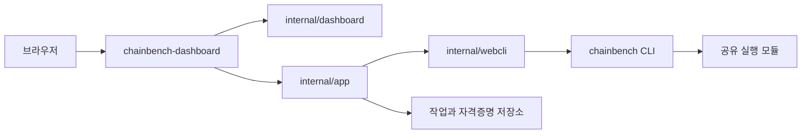
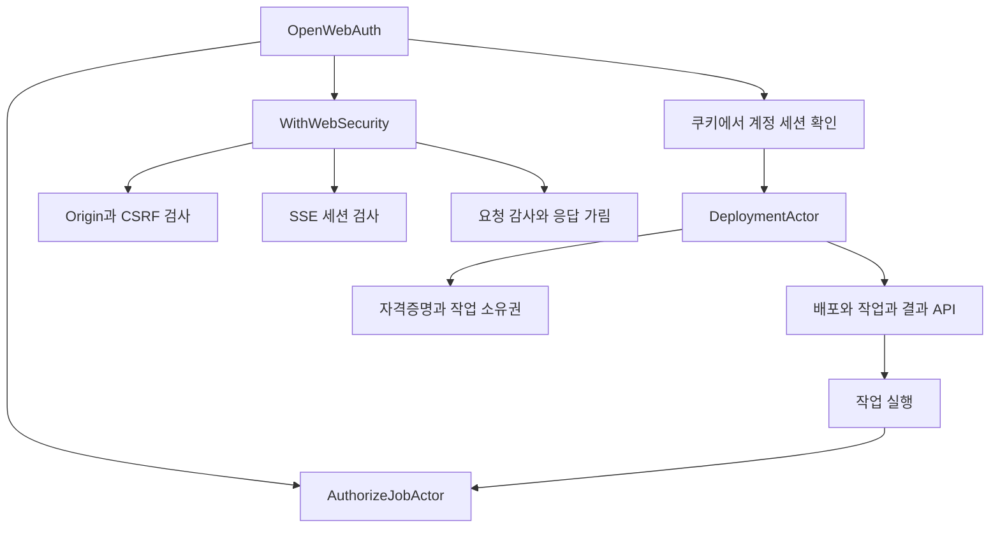
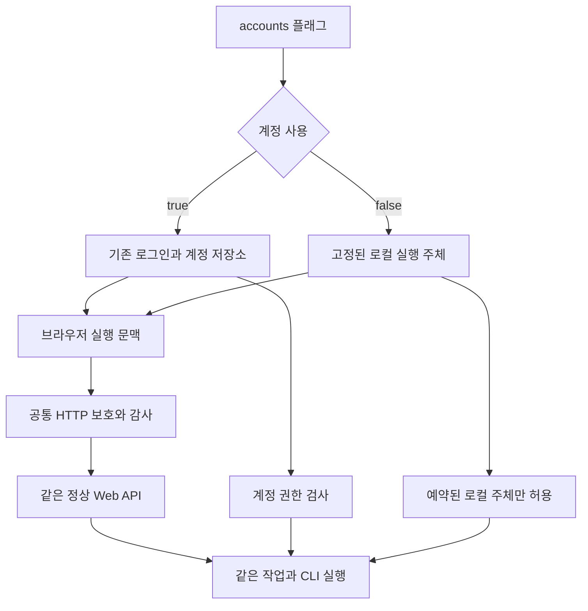
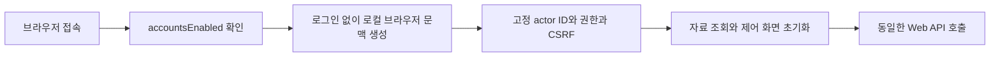

# 계정과 실행 주체의 연결

아래 그림은 AST import 그래프와 실제 호출 지점을 함께 읽어 만든 것이다. HTTP 경로와 함수 값의 연결은 코드로 확인했다. 제안 그림은 현재 구현과 구분했다.

## 현재 진입점

**이 그림이 말하는 것:** 로그인 선택은 대시보드의 요청 처리와 실행 주체 조립에 영향을 준다. 체인 실행을 별도로 구현할 이유는 없다. Web은 이미 CLI를 실행하도록 연결돼 있다. (`cmd/chainbench-dashboard/main.go:135-142`, `internal/webcli/runner.go:48-59`)

## 현재 계정 흐름

**이 그림이 말하는 것:** 요청에서 인증을 통과한 뒤에도 작업은 실행 권한을 다시 확인한다. 둘 중 한쪽만 끄면 기능이 실패하거나 보호가 빠진다. (`internal/dashboard/security.go:21-26`, `internal/dashboard/security.go:33-43`, `internal/dashboard/security.go:74-104`, `internal/app/web_job_execution.go:54-80`)

## 제안하는 선택 구조

**이 그림이 말하는 것:** 로그인 계정은 선택 가능하게 만든다. 실행 주체와 HTTP 보호는 두 모드 모두 제공한다. 이는 기존 `DeploymentAuthenticator`와 authorizer 주입 지점을 사용하는 제안이다. (`internal/dashboard/deployment.go:17`, `internal/app/web_chain_engine.go:51-56`, `internal/app/web_chain_engine.go:118-125`)

## 무계정 첫 접속 제안

**이 그림이 말하는 것:** 비밀번호를 입력하는 단계는 없어도 화면이 사용할 실행 문맥은 있어야 한다. 현재 `webSession=undefined`는 초기 자료 조회를 막는다. 계정 없는 브라우저 문맥은 사용자 등록과 다른 기능이다. (`web/src/LoginPanel.svelte:10-15`, `web/src/JobPanel.svelte:96`, `web/src/web-api.mjs:6-12`)

전체 import 그림은 [Go 패키지 SVG](graph/go-packages.svg)와 [웹 파일 SVG](graph/web-files.svg)에 있다. 둘은 실행 순서가 아니라 의존 관계를 나타낸다.
